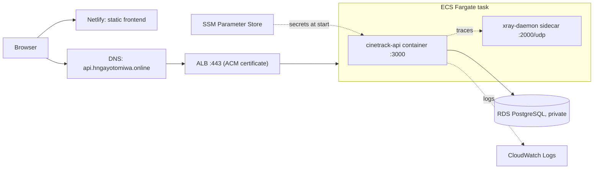
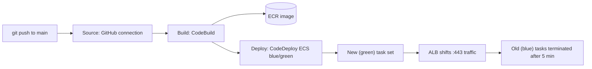

# CineTrack API

CineTrack is a movie catalogue and personal watchlist API. Users register, browse a shared catalogue of movies, and keep their own watchlist with a status (`planned`, `watching`, `completed`) and a 1-10 rating.

The application is small on purpose. The interesting part of this project is how it ships: every push to `main` is tested, containerised, pushed to a private registry and rolled out to AWS ECS Fargate with a **blue/green deployment** managed by AWS CodeDeploy, with automatic rollback if the new version fails its health checks. No step in that chain needs the AWS console.

| What | Where |
|---|---|
| API (production) | https://api.hngayotomiwa.online |
| Health check | https://api.hngayotomiwa.online/health |
| Frontend (Netlify) | https://cinetrack.hngayotomiwa.online |
| Frontend repository | https://github.com/Zaamaar/cinetrack-frontend |

## Table of contents

1. [Overview](#1-overview)
2. [Architecture](#2-architecture)
3. [Repository layout](#3-repository-layout)
4. [API reference](#4-api-reference)
5. [Data model](#5-data-model)
6. [Configuration](#6-configuration)
7. [Local development](#7-local-development)
8. [CI/CD pipeline](#8-cicd-pipeline)
9. [Operating the service](#9-operating-the-service)
10. [Bootstrapping a new AWS account](#10-bootstrapping-a-new-aws-account)
11. [DNS and TLS](#11-dns-and-tls)
12. [Security notes](#12-security-notes)
13. [Troubleshooting](#13-troubleshooting)
14. [Author](#14-author)

---

## 1. Overview

- **Runtime:** Node.js 20, Express 4, PostgreSQL via `pg`
- **Auth:** email + password, bcrypt-hashed (10 rounds), JWT access tokens valid for 7 days
- **Container:** multi-stage Docker image, runs as a non-root user
- **Compute:** AWS ECS on Fargate (no servers to manage), 0.25 vCPU / 512 MB per task
- **Database:** Amazon RDS for PostgreSQL, private (reachable only from the ECS tasks)
- **Delivery:** AWS CodePipeline -> CodeBuild -> CodeDeploy (ECS blue/green)
- **Observability:** CloudWatch Logs and AWS X-Ray (daemon sidecar in every task)

## 2. Architecture

### Runtime



### Delivery pipeline



### Resource inventory (us-east-1)

| Resource | Name |
|---|---|
| ECR repository | `cinetrack-api` |
| ECS cluster | `cinetrack-cluster` |
| ECS service | `cinetrack-service` (deployment controller: `CODE_DEPLOY`) |
| Task definition family | `cinetrack-api` (containers: `cinetrack-api`, `xray-daemon`) |
| Load balancer | `cinetrack-alb` |
| Listeners | `:80` redirects to HTTPS, `:443` production traffic, `:8080` CodeDeploy test traffic (not opened in the security group) |
| Target groups | `cinetrack-tg` and `cinetrack-tg-2` (blue and green swap between them) |
| Database | RDS PostgreSQL instance `cinetrack-db`, database `cinetrack_db` |
| CodeBuild project | `cinetrack-build` |
| CodeDeploy | application `cinetrack-app`, deployment group `cinetrack-dg` |
| Pipeline | `cinetrack-pipeline` |
| GitHub connection | `cinetrack-github` (CodeStar Connections, must be `AVAILABLE`) |
| Artifact bucket | `cinetrack-pipeline-artifacts-<account-id>` |
| Log group | `/ecs/cinetrack-api` (stream prefixes `ecs` and `xray`) |
| Security groups | `cinetrack-alb-sg` (80/443 from anywhere), `cinetrack-ecs-sg` (3000 from the ALB only), `cinetrack-db-sg` (5432 from the ECS tasks only) |

IAM roles:

| Role | Purpose |
|---|---|
| `cinetrackTaskExecutionRole` | ECS pulls the image, writes logs, reads `/cinetrack/*` SSM parameters |
| `cinetrackTaskRole` | what the running container may do (X-Ray write access) |
| `cinetrack-codebuild-role` | CodeBuild: logs, ECR push, artifact bucket, two SSM parameters |
| `cinetrack-codedeploy-role` | CodeDeploy: managed policy `AWSCodeDeployRoleForECS` |
| `cinetrack-pipeline-role` | CodePipeline: bucket, GitHub connection, CodeBuild, CodeDeploy, ECS, `iam:PassRole` for the two task roles |

## 3. Repository layout

```
.
├── server.js                 Express app: CORS, X-Ray, /health, routes, error handling
├── src/
│   ├── db.js                 pg connection pool (X-Ray instrumented)
│   ├── middleware/auth.js    Bearer-token JWT verification, sets req.userId
│   ├── models/schema.sql     Database schema (idempotent)
│   └── routes/
│       ├── auth.js           POST /register, POST /login
│       ├── movies.js         GET /, POST /
│       └── watchlist.js      GET /, POST /, PATCH /:id, DELETE /:id
├── scripts/seed-movies.sh    Seeds 20 demo movies through the public API
├── Dockerfile                Multi-stage, non-root, image-level healthcheck
├── docker-compose.yml        Local API + Postgres (schema auto-loaded)
├── buildspec.yml             CodeBuild: test, build, push, template the task definition
├── appspec.yaml              CodeDeploy ECS blue/green specification
├── task-definition.json      Fargate task: API container + X-Ray sidecar
├── AWS_SETUP.md              Original manual runbook (rolling deploy, kept for history)
└── .env.example              Local environment template
```

## 4. API reference

Base URL: `https://api.hngayotomiwa.online`. All request and response bodies are JSON. Protected routes need the header `Authorization: Bearer <token>`.

| Method | Path | Auth | Purpose |
|---|---|---|---|
| GET | `/health` | no | Liveness check used by the load balancer |
| POST | `/api/auth/register` | no | Create an account, returns a token |
| POST | `/api/auth/login` | no | Log in, returns a token |
| GET | `/api/movies` | no | Latest 100 movies, newest first |
| POST | `/api/movies` | yes | Add a movie to the catalogue |
| GET | `/api/watchlist` | yes | Your watchlist joined with movie details |
| POST | `/api/watchlist` | yes | Add a movie to your list (upsert) |
| PATCH | `/api/watchlist/:id` | yes | Update status and/or rating |
| DELETE | `/api/watchlist/:id` | yes | Remove an entry |

### Health

```bash
curl -i https://api.hngayotomiwa.online/health
# 200  {"status":"ok","service":"cinetrack-api"}
```

### Register

```bash
curl -X POST https://api.hngayotomiwa.online/api/auth/register \
  -H 'Content-Type: application/json' \
  -d '{"email":"you@example.com","password":"at-least-8-chars"}'
```

| Status | Body |
|---|---|
| 201 | `{"user":{"id":1,"email":"you@example.com","created_at":"..."},"token":"<jwt>"}` |
| 400 | `{"error":"Email and password are required"}` or `{"error":"Password must be at least 8 characters"}` |
| 409 | `{"error":"Email already registered"}` |

### Login

```bash
curl -X POST https://api.hngayotomiwa.online/api/auth/login \
  -H 'Content-Type: application/json' \
  -d '{"email":"you@example.com","password":"at-least-8-chars"}'
```

Returns `200 {"user":{"id":1,"email":"..."},"token":"<jwt>"}`, or `401 {"error":"Invalid credentials"}` (the same message for a wrong email and a wrong password).

### Movies

```bash
# public
curl https://api.hngayotomiwa.online/api/movies

# authenticated: title is required, genre and release_year are optional
curl -X POST https://api.hngayotomiwa.online/api/movies \
  -H "Authorization: Bearer $TOKEN" -H 'Content-Type: application/json' \
  -d '{"title":"Inception","genre":"Sci-Fi","release_year":2010}'
```

### Watchlist

```bash
# add (status defaults to "planned"; adding the same movie again just updates its status)
curl -X POST https://api.hngayotomiwa.online/api/watchlist \
  -H "Authorization: Bearer $TOKEN" -H 'Content-Type: application/json' \
  -d '{"movie_id":1,"status":"watching"}'

# list
curl https://api.hngayotomiwa.online/api/watchlist -H "Authorization: Bearer $TOKEN"

# update status and/or rating (rating is 1-10)
curl -X PATCH https://api.hngayotomiwa.online/api/watchlist/1 \
  -H "Authorization: Bearer $TOKEN" -H 'Content-Type: application/json' \
  -d '{"status":"completed","rating":9}'

# remove
curl -X DELETE https://api.hngayotomiwa.online/api/watchlist/1 -H "Authorization: Bearer $TOKEN"
```

Every watchlist query is filtered by the authenticated user's id, so one user can never read or change another user's entries.

### Errors

| Status | Meaning |
|---|---|
| 400 | Missing or invalid input |
| 401 | Missing, malformed, invalid or expired token |
| 404 | Unknown route, unknown movie, or watchlist entry not found |
| 409 | Email already registered |
| 500 | Unexpected server error (details go to the logs, never the response) |

## 5. Data model

Defined in `src/models/schema.sql` (safe to run repeatedly).

| Table | Columns |
|---|---|
| `users` | `id` serial PK, `email` unique not null, `password_hash`, `created_at` |
| `movies` | `id` serial PK, `title` not null, `genre`, `release_year`, `added_by` -> `users.id`, `created_at` |
| `watchlist` | `id` serial PK, `user_id` -> `users.id` (cascade), `movie_id` -> `movies.id` (cascade), `status` (`planned` / `watching` / `completed`), `rating` (1-10), `created_at`, unique `(user_id, movie_id)` |

Indexes: `idx_watchlist_user` on `watchlist(user_id)` and `idx_movies_title` on `movies(title)`.

The application does not seed data on its own. A fresh database has an empty catalogue, so load the demo movies with:

```bash
bash scripts/seed-movies.sh
```

## 6. Configuration

| Variable | Default | Notes |
|---|---|---|
| `PORT` | `3000` | |
| `JWT_SECRET` | none | required; use a long random value |
| `DB_HOST` | `localhost` | |
| `DB_PORT` | `5432` | |
| `DB_USER` | `cinetrack_user` | |
| `DB_PASSWORD` | none | |
| `DB_NAME` | `cinetrack_db` | |
| `DB_SSL` | `false` | set `true` for RDS |

In production the task definition injects these from SSM Parameter Store, so nothing secret is in the repository or the image.

| Parameter | Type |
|---|---|
| `/cinetrack/jwt_secret` | SecureString |
| `/cinetrack/db_password` | SecureString |
| `/cinetrack/db_host`, `db_port`, `db_user`, `db_name`, `db_ssl` | String |

CORS is an allowlist in `server.js` (`allowedOrigins`): the Netlify site and `https://cinetrack.hngayotomiwa.online`. Add any new frontend origin there.

## 7. Local development

### Option A: Docker Compose (API and Postgres, schema auto-loaded)

```bash
git clone https://github.com/Zaamaar/cinetrack-api.git
cd cinetrack-api
docker compose up --build
curl -i http://localhost:3000/health
bash scripts/seed-movies.sh   # run with API_URL=http://localhost:3000
```

For the seed script locally: `API_URL=http://localhost:3000 bash scripts/seed-movies.sh`.

### Option B: Node directly (needs your own Postgres)

```bash
npm install
cp .env.example .env     # fill in DB_* and JWT_SECRET
npm run dev              # nodemon
```

Load the schema into your database with `psql -f src/models/schema.sql`.

### Tests

```bash
npm test
```

`npm test` runs Jest with `--passWithNoTests`, and the repository does not contain tests yet. The pipeline runs this command, so a green build currently proves the dependencies install and nothing more. Adding Supertest tests for `/health` and the auth routes is the next quality improvement (see [Security notes](#12-security-notes)).

## 8. CI/CD pipeline

`cinetrack-pipeline` has three stages. A push to `main` starts it automatically (the GitHub connection has change detection on).

### Source

CodePipeline pulls the repository through the `cinetrack-github` connection (an authorised GitHub App installation, not a personal access token) and passes it on as a zip artifact.

### Build (`buildspec.yml`)

1. **pre_build:** log in to ECR, set `IMAGE_TAG` to the first 7 characters of the commit SHA, run `npm ci` and `npm test`.
2. **build:** `docker build`, tagged `:latest` and `:<sha>`.
3. **post_build:** push both tags, then rewrite the image URI inside `task-definition.json` to the immutable `:<sha>` tag.
4. **artifacts:** `task-definition.json` and `appspec.yaml`.

The CodeBuild project needs the environment variable `ECR_REPO_URI` (the full repository URI) and privileged mode (to run Docker).

### Deploy (CodeDeploy ECS blue/green)

1. CodeDeploy registers a **new task definition revision** from `task-definition.json`. Revisions are immutable, which is what makes rollback possible.
2. It starts the new tasks (green) behind the idle target group.
3. It waits for them to pass the ALB health check on `/health`.
4. It shifts production traffic (listener `:443`) from the old target group to the new one (`CodeDeployDefault.ECSAllAtOnce`). Test traffic is available on listener `:8080` before the shift.
5. It keeps the old tasks (blue) for **5 minutes**, then terminates them.
6. If the deployment fails, traffic stays on (or returns to) the old tasks automatically.

A task never receives user traffic until it has proved healthy, and a failed deploy does not take the API down.

### Account-specific values

`task-definition.json` (image URI, role ARNs, SSM parameter ARNs) and the `sed` line in `buildspec.yml` contain the AWS account id. When moving to a different account, update them all:

```bash
grep -rn "<old-account-id>" . --exclude-dir=node_modules --exclude-dir=.git
```

## 9. Operating the service

```bash
# trigger a deploy without a new commit
aws codepipeline start-pipeline-execution --name cinetrack-pipeline

# watch the stages
aws codepipeline get-pipeline-state --name cinetrack-pipeline \
  --query "stageStates[].{Stage:stageName,Status:latestExecution.status}" --output table

# follow the CodeDeploy deployment
DEP=$(aws deploy list-deployments --application-name cinetrack-app \
  --deployment-group-name cinetrack-dg --query 'deployments[0]' --output text)
aws deploy get-deployment --deployment-id $DEP \
  --query 'deploymentInfo.[status,errorInformation.message]' --output text

# is the service healthy?
aws ecs describe-services --cluster cinetrack-cluster --services cinetrack-service \
  --query 'services[0].{running:runningCount,desired:desiredCount,taskDef:taskDefinition}'

# application logs
aws logs tail /ecs/cinetrack-api --since 15m --follow

# end-to-end check
curl -i https://api.hngayotomiwa.online/health
```

A green pipeline stage only means AWS accepted the deployment. The `/health` response is the real proof.

**Rollback**

- Automatic: a failed deployment rolls back on its own.
- Stop a deployment in progress: `aws deploy stop-deployment --deployment-id $DEP --auto-rollback-enabled`
- After a successful but bad release: `git revert <commit> && git push` and let the pipeline ship the previous behaviour.

## 10. Bootstrapping a new AWS account

Everything is recreated in this order. The details of each step are in the resource inventory above.

1. Region `us-east-1`; confirm access with `aws sts get-caller-identity`.
2. Security groups: ALB, ECS, DB (ALB -> ECS on 3000, ECS -> DB on 5432).
3. IAM: the two task roles, then the CodeBuild, CodeDeploy and pipeline roles.
4. SSM parameters under `/cinetrack/`, with a random `jwt_secret` and `db_password`.
5. RDS PostgreSQL `cinetrack-db` (encrypted, automated backups on), then `db_host` into SSM, then load `src/models/schema.sql`, then lock the database to private.
6. ECR repository, then build and push the first image (`docker build --platform linux/amd64`, because Fargate runs x86).
7. CloudWatch log group `/ecs/cinetrack-api`, ECS cluster, register `task-definition.json`.
8. ALB with target groups `cinetrack-tg` and `cinetrack-tg-2`, listeners `:80`, `:443` and `:8080`.
9. ECS service **created with `--deployment-controller type=CODE_DEPLOY`** (an existing service cannot be switched; delete and recreate it).
10. ACM certificate and DNS records (next section).
11. CodeDeploy application and deployment group, CodeBuild project (with `ECR_REPO_URI`), artifact bucket.
12. GitHub connection: create it, then approve it once in the console (Developer Tools -> Settings -> Connections -> Update pending connection).
13. Create `cinetrack-pipeline`, push a commit, watch it go green.
14. Seed the catalogue: `bash scripts/seed-movies.sh`.

## 11. DNS and TLS

DNS is managed at Namecheap (Advanced DNS). There is no Route 53 hosted zone.

| Type | Host | Value |
|---|---|---|
| CNAME | `api` | the ALB DNS name (`cinetrack-alb-....us-east-1.elb.amazonaws.com`) |
| CNAME | `cinetrack` | the Netlify site (`...netlify.app.`) |
| CNAME | `_<token>.api` | the ACM validation target (copy the exact pair from `aws acm describe-certificate`) |

Notes:

- In Namecheap, **Host is entered without the domain suffix**. For `_abc.api.hngayotomiwa.online.` enter `_abc.api`.
- The ACM validation record must match the certificate you actually requested. Each new certificate request gets its own record, and a stale record from an old request does nothing.
- **Keep the validation record permanently.** ACM uses it to renew the certificate automatically.
- The HTTPS listener uses the TLS policy `ELBSecurityPolicy-TLS13-1-2-2021-06`.

## 12. Security notes

**In place**

- Passwords hashed with bcrypt; login returns the same error for unknown email and wrong password
- All SQL is parameterised; watchlist queries are scoped to the authenticated user
- Secrets live in SSM Parameter Store, never in the repository or image
- Container runs as a non-root user; the database has no public access and accepts connections only from the ECS security group
- HTTPS everywhere, with HTTP redirected to HTTPS at the load balancer
- CORS restricted to an explicit allowlist of origins

**Known limitations (honest list)**

- Database TLS uses `rejectUnauthorized: false`, so the connection is encrypted but the server certificate is not verified. Load the RDS CA bundle and enable verification.
- No rate limiting on `/api/auth/*` and no `helmet` headers.
- `PATCH /api/watchlist/:id` does not validate `status` and `rating` in code. The database constraints reject bad values, but the API currently answers with a 500 instead of a 400.
- Registration checks for an existing email and then inserts, which has a small race. Catching the unique-violation error would be cleaner.
- `npm test` has no tests yet.
- The error handler sends the response without calling `next(err)`, so X-Ray may not mark those requests as faults.
- The X-Ray daemon image and the `:latest` image tag are not pinned to specific versions, and the X-Ray sidecar is marked `essential`, so if it crashes the whole task restarts.

## 13. Troubleshooting

| Symptom | Cause and fix |
|---|---|
| Frontend shows "Failed to fetch" | The browser got no usable response. Check `curl -i https://api.hngayotomiwa.online/health`. If the API is up, check DevTools -> Network for the exact URL; an HTTPS page cannot call an HTTP API. |
| ALB returns `503` | No healthy targets. Check `aws ecs describe-services ... events` and `aws logs tail /ecs/cinetrack-api`. A new task needs 1-3 minutes to become healthy. |
| Task stops with `exec format error` | The image was built for ARM. Build with `docker build --platform linux/amd64`. |
| `ping` to the ALB shows 100% loss | Expected. Load balancers do not answer ICMP. Use `curl`. |
| `aws` cannot resolve any hostname but `nslookup` works | Your system DNS resolver is broken. Set explicit DNS servers on the network interface. |
| `dig @1.1.1.1` times out | Your network blocks that resolver. Query the authoritative server instead (`dig ... @dns1.registrar-servers.com`) or use `https://dns.google/resolve?name=...`. |
| ACM certificate stuck in `PENDING_VALIDATION` | The DNS record does not match this certificate. Print the expected name and value with `aws acm describe-certificate`, add exactly that, and delete stale ones. |
| `UnsupportedCertificate` when creating the HTTPS listener | The certificate is not `ISSUED` yet. Wait for validation. |
| IAM `MalformedPolicyDocument` on a policy built in zsh | zsh read `$ACCT:r...` as a modifier. Write `${ACCT}` with braces. |
| `In function length(), invalid type for value: None` | Harmless AWS CLI waiter bug when a service response is empty. Poll target health instead of using `aws ecs wait`. |
| Source stage fails | The GitHub connection is not `AVAILABLE`. Approve it in the console. |
| Build fails at `docker login` | `ECR_REPO_URI` is missing or wrong in the CodeBuild project. |
| Deploy fails on a listener or target group | Run `aws deploy get-deployment ... errorInformation`. Check that listeners `:443` and `:8080` and both target groups exist. |
| Empty dashboard after login | The catalogue is empty. Run `bash scripts/seed-movies.sh`. |
| ECS cluster or service dropdowns empty in the console | They load on interaction. Click into the field. |

## 14. Author

Tom Ayorinde - https://github.com/Zaamaar
